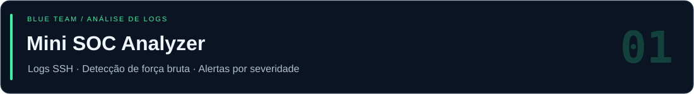

<div align="center">



**Segurança da Informação · Desenvolvimento em Python · IA aplicada à segurança**

[](https://www.linkedin.com/in/geovani-rodrigues-de-almeida)
[](https://www.linkedin.com/in/geovani-rodrigues-de-almeida)

[Sobre mim](#-sobre-mim) &nbsp; / &nbsp; [Projetos](#-projetos-em-destaque) &nbsp; / &nbsp; [Cyber + IA](#-cibersegurança--inteligência-artificial) &nbsp; / &nbsp; [Formação](#-formação-acadêmica)

</div>

## 🧑‍💻 Sobre mim

Sou o **Geovani**, estudante de Tecnólogo na área de TI (conclusão prevista para **dezembro de 2027**), e estou construindo minha carreira em **Segurança da Informação**. Estudo pentest em redes, web, sistemas operacionais e nuvem e pratico em **CTFs e wargames**.

Aprendo na prática: entre meus projetos em Python estão um **scanner de portas com interface gráfica** e um **analisador de logs que detecta tentativas de força bruta**. Agora estou explorando como usar **IA para apoiar a análise de segurança**.

**Busco estágio em TI e segurança.** Me encontre no [LinkedIn](https://www.linkedin.com/in/geovani-rodrigues-de-almeida).

---

## 🛡️ Projetos em destaque

### 01 · Mini SOC Analyzer

[](https://github.com/ge454/mini-soc-analyzer)

**Um login aceito depois de várias falhas merece atenção.**

Analisador de logs de autenticação SSH que identifica possíveis tentativas de força bruta e sinaliza acessos bem-sucedidos após falhas do mesmo IP.

- **Detecta padrões suspeitos:** contabiliza falhas por IP com limite configurável.
- **Ajuda a priorizar a investigação:** classifica a severidade em média, alta e crítica.
- **Preserva o contexto:** reúne usuários testados e horários da primeira e da última falha.
- **Documenta os resultados:** exibe o relatório no terminal e permite exportação em texto.

**Tecnologias:** `Python` · `Regex` · `argparse` · `SSH / syslog`

[](https://github.com/ge454/mini-soc-analyzer#readme)
[Ver código-fonte ↗](https://github.com/ge454/mini-soc-analyzer/blob/HEAD/soc_analyzer.py)

<details>
<summary><strong>🔎 Veja um exemplo de alerta</strong></summary>

Exemplo ilustrativo com dados fictícios:

```text
[CRITICA] 203.0.113.45
    tentativas: 14 | de Nov 01 08:45:00 ate Nov 01 08:46:57
    usuarios testados: admin, oracle, root, test, ubuntu

--- ALERTA: login bem-sucedido apos varias falhas ---
203.0.113.45 entrou como 'admin' as Nov 01 08:47:10 depois de 14 falhas. Investigar.
```

</details>

---

### 02 · SENAI Port Scanner

[](https://github.com/ge454/port-scanner-python)

**Da descoberta de portas ao relatório em PDF.**

Scanner com interface gráfica que verifica um intervalo de portas TCP, associa serviços conhecidos pelo número da porta e tenta capturar banners de resposta.

- **Facilita a operação:** permite configurar o alvo e o intervalo de portas em uma interface Tkinter.
- **Executa verificações simultâneas:** utiliza `ThreadPoolExecutor` para a varredura.
- **Apresenta informações úteis:** lista portas abertas, serviços associados e banners disponíveis.
- **Consolida os resultados:** gera um PDF com resumo e tabela quando encontra portas abertas.

**Tecnologias:** `Python` · `socket` · `Tkinter` · `concurrent.futures` · `FPDF`

[](https://github.com/ge454/port-scanner-python#readme)
[Ver código-fonte ↗](https://github.com/ge454/port-scanner-python/blob/HEAD/port_scanner.py)

*Projetos de estudo que conectam programação, redes e análise de segurança.*

---

## 🧠 Cibersegurança × Inteligência Artificial

**Meu próximo foco de aprendizado: explorar como a IA pode apoiar a análise de segurança.**

Quero investigar formas de organizar evidências, interpretar eventos e apoiar a análise de logs, mantendo a validação dos resultados como parte do processo.

| Frente | O que estou estudando ou explorando |
| :--- | :--- |
| **Segurança ofensiva** | Pentest em redes, web, sistemas operacionais e nuvem; prática em CTFs e wargames. |
| **Segurança defensiva** | Análise de logs, detecção de força bruta e correlação de eventos de autenticação. |
| **Desenvolvimento** | Ferramentas em Python, interfaces gráficas, conexões TCP e geração de relatórios. |
| **Inteligência Artificial** | Possibilidades de aplicação da IA como apoio à análise de segurança. |

---

## 🎓 Formação acadêmica

### Graduação em Segurança Cibernética
**Faculdade Senai São Caetano — Cyber e IA**  
📚 Em andamento · **Conclusão prevista: dezembro de 2027**

### Curso Técnico em Análise e Desenvolvimento de Sistemas
**Senai A. Jacob Lafer**  
🎓 Concluído em **2025**

---

<div align="center">

### Vamos nos conectar?

Busco uma oportunidade de **estágio em TI e Segurança da Informação** para aprender, contribuir e evoluir com desafios reais.

[](https://www.linkedin.com/in/geovani-rodrigues-de-almeida)

**Aprender. Construir. Investigar. Evoluir.**

[Explore meus repositórios ↗](https://github.com/ge454?tab=repositories)

</div>
